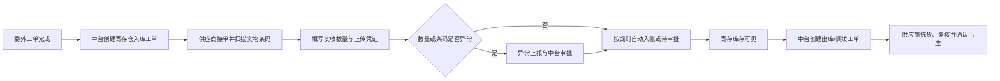

# 委外供应商寄存仓库协同设计

日期：2026-10-15

## 目标

委外加工工厂、物料供应商和包材供应商可能同时承担仓储职责：生产或交付完成后，货物先暂存在供应商处，后续再根据中台指令入库、出库、盘点或调拨。

系统采用“组织身份 + 资源授权”的混合角色模型：供应商组织继续保留原业务身份和订单协同能力，并可额外绑定一个或多个国内仓资源。伙伴使用同一个账号进入工作台，根据授权同时看到生产/采购协同与寄存仓库模块。

## 不采用的方案

1. 不为同一家供应商再创建一个仓库组织。该方式会产生重复账号、重复成员和任务上下文切换。
2. 不建立供应商独立库存账。库存仍以国内仓主账为准，避免形成双主账和盘点差异。
3. 不因“生产已完成”直接增加库存。必须通过明确的入库工单、扫码确认和审核链路形成可追溯库存流水。

## 权限与数据边界

- 组织身份决定供应商可以看到的加工单、采购单、打样单等业务数据。
- 仓库授权决定供应商可以看到的库存、仓储工单和仓储操作。
- 每个仓库权限使用 `resource_type=warehouse + resource_ref=仓库ID` 精确授权。
- 一个供应商可绑定多个寄存仓，但只能访问已授权仓库。
- 委外工厂之间、供应商之间默认互不可见；同一组织下成员继续受成员角色限制。
- 数据库 RLS 和 API 权限同时校验组织与仓库资源，禁止“没有仓库范围等于全部仓库”。

建议的寄存仓默认权限：

- 查看库存
- 查看仓储工单
- 接单与反馈进度
- 确认入库、确认出库、确认调拨收货
- 上报异常、上传凭证
- 发起盘盈盘亏申请
- 完成工单

盘盈盘亏、超量差异、费用和基础档案修改仍需中台审批，不允许伙伴直接修改库存主账。

## 伙伴端信息架构

伙伴工作台根据实际授权动态显示模块：

- 生产协同：仅委外工厂有对应订单权限时显示。
- 采购协同：仅物料或包材采购权限存在时显示。
- 打样协同：仅对应打样权限存在时显示。
- 寄存仓库：存在 `warehouse.inventory.view` 时显示，展示有库存的 SKU、库存图片、可用/锁定/在途、最近同步时间。
- 仓储工单：存在 `warehouse.task.view` 时显示，集中处理入库、出库、调拨、盘点和异常任务。

供应商是混合角色时，普通“协同任务”不混入仓储工单，避免加工单与仓库操作堆在同一列表；仓储任务单独进入“仓储工单”。

## 中台授权体验

协同组织权限页在原有业务协作空间之外增加“寄存仓库”资源组：

- 管理员勾选一个或多个已存在的国内仓。
- 每个仓库可分别配置库存查看、工单查看、入出库确认、盘点申请、异常上报等权限。
- “使用推荐权限”根据组织类型给出保守默认值。
- 已填写的仓库绑定信息继续复用，不要求重复维护仓库编码或接口配置。

## 真实业务闭环

生产完成只提供创建入库工单的快捷入口，不直接改变库存。库存变化必须来自幂等仓储指令，并记录操作者、组织、仓库、数量、条码、附件、时间和审核结果。

## 验收标准

1. 委外工厂未绑定仓库时，伙伴端看不到寄存仓库及仓储工单入口。
2. 绑定仓库 A 后，可以看到 A 的库存和工单，不能通过列表、搜索、详情 ID 或接口参数看到仓库 B。
3. 同一账号可在加工单与寄存仓库之间切换，无需创建第二个账号。
4. 普通协同任务与仓储工单分栏展示。
5. 伙伴确认入库/出库不能绕过权限、版本、幂等和审批规则。
6. 库存只展示有库存商品，并显示图片与最后同步时间。
7. 取消仓库授权后，现有会话立即失去该仓访问能力，但审计记录保留。
8. API 过滤遗漏时，PostgreSQL RLS 仍拒绝跨组织或跨仓访问。

